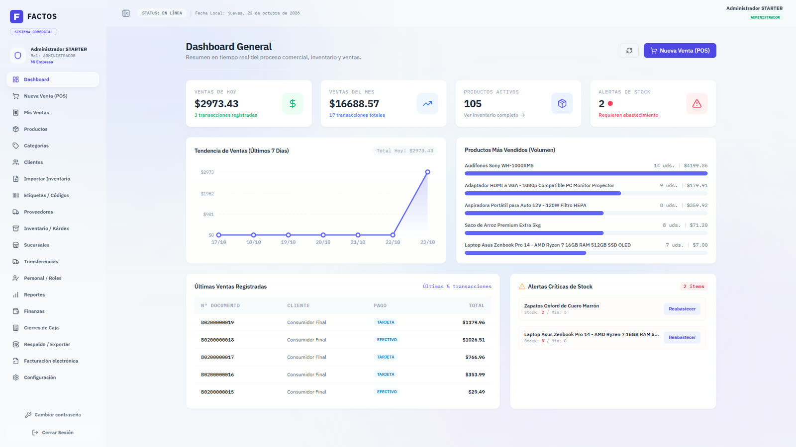
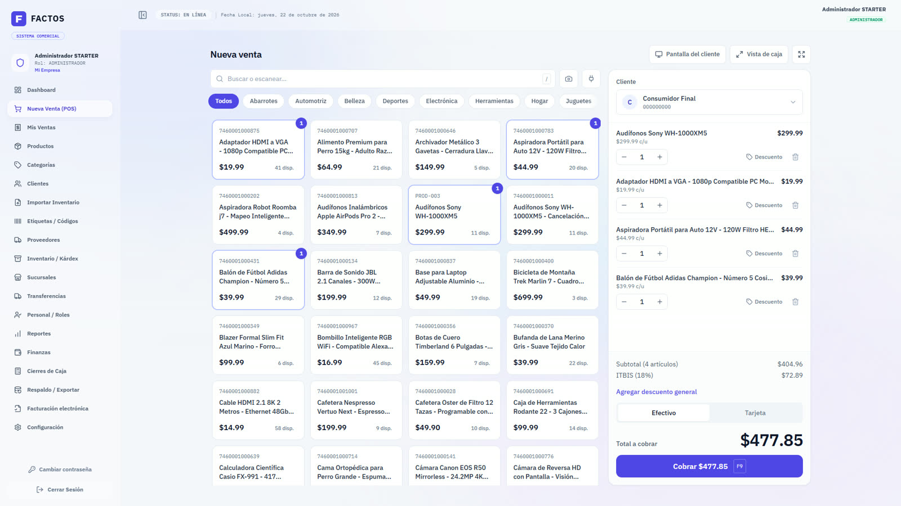
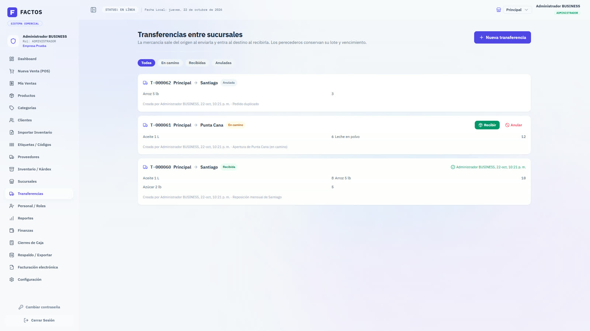
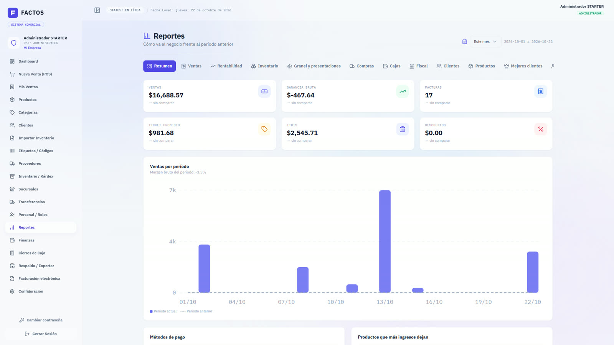

# FACTOS

**Punto de venta, inventario, cajas y facturación en la nube para negocios de República Dominicana.**
*(Antes llamado SalesPro.)*

Cobra, controla tu inventario y cierra caja sin hojas de cálculo. FACTOS está pensado para tiendas, colmados, ferreterías y negocios con varias sucursales, y funciona en cualquier navegador, sin instalar nada.

▶ [Ver el video promocional](media/factos-promo.mp4) (68 s)

## Qué hace

- **Punto de venta rápido**: escanea con lector USB o con la cámara del celular, cobra en efectivo o con tarjeta, imprime el ticket y abre una pantalla de cara al cliente.
- **Comprobantes fiscales**: numeración de NCF controlada por el sistema y facturación electrónica (e-CF) preparada para la DGII.
- **Inventario con kárdex**: compras, ajustes, mermas, importación desde hoja de cálculo, lotes con fecha de vencimiento y alertas de stock bajo.
- **Varias sucursales**: stock por sucursal, transferencias con recepción, cajas y reportes por sucursal.
- **Cierre de caja**: turnos por cajero, conteo de billetes y monedas, y diferencia a la vista.
- **Reportes**: ventas, rentabilidad, inventario, compras, impuestos, clientes y horas pico.
- **Etiquetas con código de barras** listas para imprimir, **usuarios y roles**, y **respaldos y exportaciones** de los datos.
- **Planes Gratis, Starter y Business**, con límites claros por plan.

## Así se ve

| Panel | Punto de venta |
|---|---|
|  |  |

| Transferencias entre sucursales | Reportes |
|---|---|
|  |  |

*Capturas con datos de demostración.*

## Cómo está hecho

- **Backend**: Node.js, Express, Prisma y PostgreSQL, con arquitectura multiempresa y aislamiento de datos por empresa.
- **Frontend**: React, Vite y Tailwind CSS.
- **Calidad**: pruebas unitarias con Vitest, más de veinte scripts de pruebas de integración (aislamiento entre empresas, concurrencia de ventas, seguridad, planes y facturación electrónica contra un simulador de la DGII).
- **Seguridad**: sesiones con renovación y cierre por inactividad, claves temporales, límites por plan y respaldos cifrados.

## Estado

En desarrollo activo (beta). El código fuente es privado.

¿Quieres una demostración o conocer más del proyecto? Escríbeme desde [mi perfil de GitHub](https://github.com/Joel-S-Florian).

---

© FACTOS. Todos los derechos reservados.
